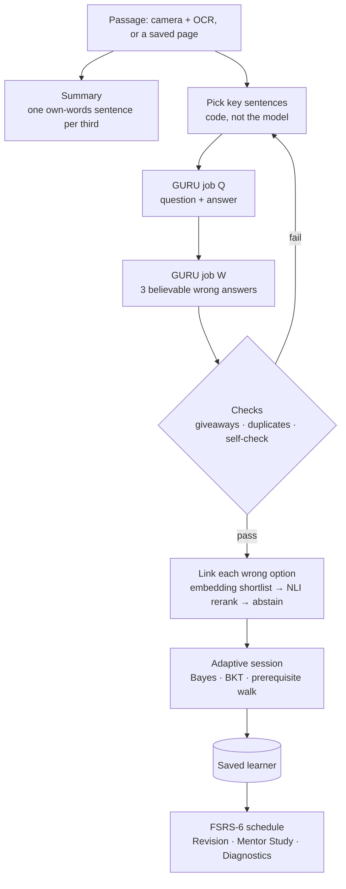
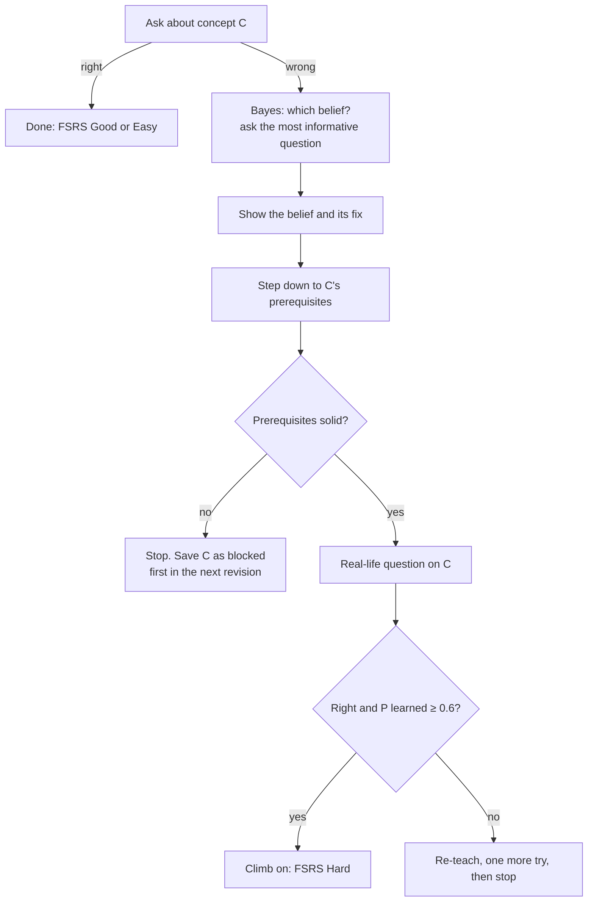
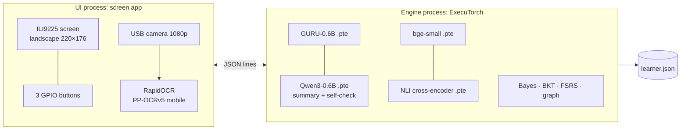

<div align="center">

# SAKSHI

**An offline tutor that diagnoses, not just scores**

*Misconception-aware quizzes, knowledge tracing and spaced revision on a Raspberry Pi 5, with the network off*

**Winner · Namma AI Hackathon 2026 (Arm × IIIT Bangalore × NASSCOM) · Problem Statement 1: AI for Inclusive Education**

Powered by **GURU-0.6B**: **G**rounded **U**nderstanding, **R**uns **U**nplugged

[Model release](https://github.com/ArushJain-697/namma-ai/releases/tag/guru-0.6b-v1) · [Design decisions](docs/JUDGE_BRIEF.md) · [Learning-engine maths](docs/RETENTION_MATH.md) · [MIT licence](LICENSE)


*The device: Raspberry Pi 5 in a 3D-printed case, 176×220 screen, three buttons, USB camera for photographing a page.*

</div>

---

## Overview

A student studying a textbook page alone has no way to check whether she understood it, and nobody to correct her
when she did not. Quizzes give her a score. A score says *that* she is wrong, never *why*. If she believes "friction
only acts on objects that are already moving", that belief follows her into every chapter built on it.

Sakshi turns a 150-300 word passage into a short summary and a **diagnostic quiz** where every wrong option is a real
student misconception from a graph of **4,080**. When she picks one, Sakshi works out which belief she holds, teaches the
fix, steps down to the idea underneath, climbs back up only when she has really learned it, and brings the belief back
on later days until it is gone. Everything runs on a **Raspberry Pi 5 with ExecuTorch, with no internet**.

The system answers six questions, in order:

1. What does this passage say, in words a Class 6-10 student can follow?
2. Which sentences are worth asking about? Code decides, never the model.
3. What would a student who misunderstood this *believe*? Each wrong option is written to be believable, then linked to a named misconception.
4. Which belief does she hold, and how sure are we? Bayes over her answers, with "no specific belief" always a hypothesis.
5. Has she learned the idea, or did she guess? Knowledge tracing separates learning from lucky guesses.
6. When will she forget it, and what should she revise first? Spaced repetition predicts forgetting per concept.

**How we built it:** research before building, measure instead of guessing, and record the limits next to the results. Every number in this README comes from a script run, and every design choice is recorded with its evidence in [`docs/JUDGE_BRIEF.md`](docs/JUDGE_BRIEF.md). One example of the research rule: we tested small fact-checking models on 10 questions with known wrong answer keys. They caught only 0-3 of 10, so that check was never shipped.

## Features

| Capability | Description |
|---|---|
| GURU-0.6B quiz model | Qwen3-0.6B fine-tuned with LoRA in two jobs: write question + answer, write 3 believable wrong answers |
| On-device inference | ExecuTorch 1.5.1, 4-bit weights / 8-bit activations, XNNPACK on the Arm Cortex-A76 CPU |
| Misconception graph | 4,080 misconceptions, 5,585 concepts, 120 root beliefs, 6,052 prerequisite links, 258 Class 6-10 topics |
| Wrong answer → belief | Embedding shortlist, NLI cross-encoder rerank, abstains when unsure; right belief in the top 3 81% of the time |
| Bayesian diagnosis | Picks the next question by expected information gain; names a belief only at 75% confidence |
| Knowledge tracing | BKT per concept; the climb back up needs a right answer *and* P(learned) ≥ 0.6 |
| Prerequisite walk | Wrong answer → fix → step down to the idea underneath → climb back up with real-life questions |
| Spaced revision | FSRS-6 per concept; review days re-check old beliefs and follow the graph to related ones |
| Quality checks | Code picks the key sentence, giveaway and duplicate checks, a second model must agree on the answer |
| Streaming quiz | Questions arrive one by one: the next is written while the child answers the current one, so she waits only for the first |
| The device | 220×176 screen, 3 buttons, camera + on-device OCR, passages loaded from storage |

> **Decision:** Qwen3-0.6B, chosen by the time budget: about one minute for a summary and a quiz on the Pi. Qwen3-1.7B carries ~3x the weights, so ~3x slower writing, and was not clearly better on our data (held-out loss 1.273 vs 1.256). [Why →](docs/JUDGE_BRIEF.md#1-model-qwen3-06b-4-bit-executorch-xnnpack-on-the-arm-cpu)

---

## Problem statement (Namma AI 2026 · Problem 1)

| Requirement | What Sakshi delivers |
|---|---|
| One learning barrier and learner group | Class 6-10 students in low-connectivity government schools, studying alone; only **67.5%** of Class 8 rural government-school students can read a Class 2 text (ASER 2024) |
| An organiser passage, lightweight model, ExecuTorch, Raspberry Pi | GURU-0.6B, **ExecuTorch 1.5.1** on a **Raspberry Pi 5 (8 GB)**, Arm CPU only |
| Summary + at least 3 quiz questions | Summary and 3+ multiple-choice questions, each answer shown with the passage sentence that proves it: **57.9 s** end to end |
| No cloud inference; report time, model, size, memory | Network off; a run card after every run: **469 MB** model, **3.2 GB** peak for the whole engine |
| Impact explanation with an example from the passage | A named misconception with its fix, e.g. *"Friction only acts on objects that are already moving"* found at 96% |

---

## Why this is different: four claims

1. **A score is not a diagnosis.** Every wrong option is linked to a named belief, so a wrong answer says *what* the child believes. The hackathon brief asked for a quiz; Sakshi returns the reason behind each mistake.
2. **The model never decides alone.** Code picks the sentence to ask about, rules reject giveaways, a second model must agree on the answer, and every answer shows the sentence that proves it. Fewer questions rather than a wrong one.

> **Decision:** we tested our own pitch claim and dropped it. A bot that just picks the option sounding most like the passage scored 66% on our best prompt-only version (chance is 25%), so "our quiz beats word-spotting" was false for it. Measurement decides what we say. [Why →](docs/JUDGE_BRIEF.md#6-question-quality-the-hardest-problem-attacked-with-measurement)
3. **One answer never labels a child.** Bayes keeps "no specific belief" as a hypothesis, so one slip is not a diagnosis; a belief is named only at 75%, and a right answer that is still inconclusive earns one more question before a belief is cleared.
4. **Learning is checked across days, not in one sitting.** Mastery today = learned × still remembered. A belief that is gone is followed through the graph to a related belief with the same root, to test whether the deeper habit is fixed.

---

## Architecture

### End-to-end pipeline



> **Decision:** one model call per question, never "all questions in one call": small models break long structured outputs. The model put the key in option A ~80% of the time, so code shuffles options; 3-option questions are kept because three options test as well as four (Rodriguez 2005, 80 years of research). [Why →](docs/JUDGE_BRIEF.md#4-time-budget-decided-from-token-counts)

### Questions arrive one by one, not all at once

The quiz is not generated in one go before the child can start. As soon as the first question passes the checks it
appears on screen, and a background thread writes, checks and links the **next** question while she reads and
answers the current one. Writing a question takes the Pi about 16 s; a child takes about 20-40 s to read and answer
one, so after the first question the waiting disappears.

| Child's wait before each question (Mac, pretend child taking 4 s per answer) | Q1 | Q2 | Q3 |
|---|---|---|---|
| Streaming (shipped) | 3.4 s | **0 s** | **0 s** |

> **Decision:** stream instead of batch. The time to *write* each question stays the same (that is the number we
> report for judging); what changes is the time the child spends *waiting*. Building it exposed a real bug: the
> ExecuTorch runner captures the model's text by redirecting the process's output, so the child's screen vanished
> into the capture and one question was lost. We proved it by ruling out threads, CPU load and the helper models,
> then gave the screen its own output channel; streaming now produces exactly the same questions as batch. [Why →](docs/JUDGE_BRIEF.md#questions-stream-to-the-child-write-the-next-one-while-the-child-answers-14-nov)

### The session: step down, climb back up



### The device



---

## Tech Stack

| Area | Technology |
|---|---|
| On-device inference | ExecuTorch 1.5.1, XNNPACK, `TextLLMRunner`, custom SDPA + KV cache |
| Models | Qwen3-0.6B → GURU-0.6B (LoRA), bge-small-en-v1.5 embedder, nli-deberta-v3-xsmall cross-encoder |
| Training | PyTorch, PEFT LoRA, answer-only loss, gradient checkpointing (CUDA or Apple MPS) |
| Export | optimum-executorch: `8da4w`, group size 32, 8-bit embeddings, `max_seq_len 1024` |
| Learning engine | Bayes with expected information gain, Bayesian Knowledge Tracing, py-fsrs 6.3.2 (FSRS-6) |
| Device | Raspberry Pi 5 (8 GB), ILI9225 SPI screen, gpiozero, OpenCV, RapidOCR on ONNX Runtime |
| Language and testing | Python 3.12-3.13, pytest |

---

## Deep Dive: The Layers

### Layer 1: the quiz model (GURU-0.6B)

One model, two jobs, chosen by the system prompt. **Job Q**: a 3-sentence window + the key sentence → question + answer.
**Job W**: + question + answer → 3 wrong answers a student would believe. Splitting the work keeps each call short
for a 0.6B model, and the combined model beat two specialists at both jobs (held-out loss 1.217 vs 1.227, 1.429 vs 1.439).

### Layer 2: wrong answer → misconception

For a wrong option *x*, candidates are the misconceptions of the passage's topics (about 4,000 → 16-50). Retrieve by
cosine similarity of unit embeddings, rerank with an NLI cross-encoder, and abstain below a similarity line:

$$\text{score}(m) = \cos(e_x, e_m) + 0.3\,P_{\text{entail}}(x \Rightarrow m), \qquad \text{link}(x) = \begin{cases} \arg\max_m \text{score}(m) & \cos \ge 0.76 \\ \text{none} & \text{otherwise} \end{cases}$$

An unlinked option is a plain wrong answer, never evidence for a belief: a weak link cannot invent a diagnosis.

> **Decision:** retrieve-and-rerank, the standard two-stage search design, scaled down to run offline on a Pi and measured on our own ~3,600 labelled pairs. The reranker adds only 1 point (46% to 47%); we kept it because it is cheap, and we report the small gain as it is. [Why →](docs/JUDGE_BRIEF.md#7-linking-each-wrong-option-to-a-misconception-retrieve-and-rerank-run-on-a-pi)

### Layer 3: Bayesian diagnosis

Hypotheses for a concept are its misconceptions plus **NONE**. If she holds belief *m* and it is on the question, she
picks its option with probability 0.70, the correct one 0.15. Posterior and next question:

$$P(h \mid o) = \frac{P(o \mid h)\,P(h)}{\sum_{h'} P(o \mid h')\,P(h')}, \qquad \text{EIG}(q) = H(P) - \sum_o P(o)\,H\big(P(\cdot \mid o)\big)$$

"Detected" at ≥ 0.75, "possible" at ≥ 0.50.

> **Decision:** "no specific belief" is always a hypothesis. Without it, any random wrong answer would look like proof of some misconception, and one slip would label a child. [Why →](docs/JUDGE_BRIEF.md#9-the-retention-engine-every-design-decision-and-why-14-nov)

### Layer 4: Bayesian Knowledge Tracing

With slip *s* = 0.10, guess *g* = 0.25 (recall) or 0.15 (real-life question) and learning rate *T* = 0.2:

$$P(L \mid \checkmark) = \frac{P(L)(1-s)}{P(L)(1-s) + (1-P(L))\,g}, \qquad P(L \mid \times) = \frac{P(L)\,s}{P(L)\,s + (1-P(L))(1-g)}, \qquad P(L) \leftarrow P(L) + (1-P(L))\,T$$

One wrong answer: 0.30 → 0.24. One right real-life answer: 0.24 → 0.72, which clears the climb gate of 0.6
(classic mastery is 0.95; 0.6 means "ready to build on").

> **Decision:** BKT, not deep knowledge tracing. Deep models perform near chance (AUC ~0.5) for brand-new students and are too heavy for a Pi; BKT works from the first answer and costs microseconds per update. [Why →](docs/JUDGE_BRIEF.md#8-learner-model-chosen-for-zero-data-and-a-small-cpu)

### Layer 5: forgetting (FSRS-6)

Per concept, stability *S* and difficulty *D*; recall after *t* days, with *F* chosen so that *R*(*S*, *S*) = 0.9:

$$R(t, S) = \left(1 + F\,\frac{t}{S}\right)^{-w_{20}}, \qquad F = 0.9^{-1/w_{20}} - 1$$

Knowledge tracing and memory join on review days, and revision is ordered by risk:

$$P(L)_{\text{today}} = P(L)_{\text{saved}} \cdot R(t, S), \qquad \text{priority}(C) = 1 - P(L)_C \cdot R_C(t)$$

> **Decision:** FSRS with default settings, said openly: a 7-day-stable memory is still ~77% at day 30, so we never draw exaggerated forgetting curves. The settings are not yet fitted to children. [Why →](docs/JUDGE_BRIEF.md#8-learner-model-chosen-for-zero-data-and-a-small-cpu)

### Layer 6: review days

Each belief she held is re-checked with a **new** question (two hypotheses, holds / does not, same likelihoods). Still
held → the fix again and an earlier review. Cleared → follow the graph to a belief it `causes`, else the nearest belief
with the same root belief in another topic, to test whether the deeper habit is fixed.

---

## Benchmarks

### On the Raspberry Pi 5 (8 GB, Cortex-A76, no network)

| Measurement | Value |
|---|---|
| Prefill / decode | **122 / 12.1 tokens/s** |
| Summary + 3 questions, one terminal run, start to finish | **57.9 s** = load 3.0 + summary 14.2 + quiz 40.7 |
| On the device, average time to write each question (hidden: written while the child answers the previous one) | **15.7 s** |
| Summary on the device (one sentence per third) | **9.2 s** |
| Peak memory: GURU alone / + summary model / whole engine | **1.48 / 2.7 / 3.2 GB** |
| Model file (4-bit) | **469 MB** |

### What we optimised, measured before and after

| Change | Before | After |
|---|---|---|
| Stop each call when the answer is complete (the model never wrote its end token) | 147 s | **86 s**, identical output |
| Context sized to the job: `max_seq_len` 2,048 → 1,024 | 2.49 GB | **1.67 GB**, same answers 8/8 |
| Second wrong-answer run removed (identical in 38/38 calls) | 6.7 s/question | **4.6 s/question** (Mac) |
| Summary: whole passage → one own-words sentence per third | 86 words, 44% copied | **44 words, 26% copied** |
| Camera capture mode | 640×360 | **1920×1080** |

> **Decision:** the context limit was sized to the job. Also measured and rejected: 4-bit embeddings (saved only 74 MB but changed all 8 test answers) and a larger quantization group (no change). [Why →](docs/JUDGE_BRIEF.md#3-memory-cut-by-a-third-with-zero-quality-change)

### Question quality (40 frozen test passages, blind-graded)

| Version | Result |
|---|---|
| Plain Qwen3-0.6B, best of 4 prompts | **19%** sensible, answer key right 73% |
| Version 1: LoRA on SciQ + RACE (4,300 questions) | **30%** sensible, answer key right 82% |
| Two-job GURU vs single-call | blind read **8/12** vs 3/12 good; answer is the longest option **6%** vs 15%; why/how questions **49%** vs 39% |

> **Decision:** the teacher data was graded before training: 2,773 questions written for 401 syllabus passages, scored by a separate grader against our rubric, and only 1,039 kept (score 4-5 and every hard rule). Zero overlap with the 40 test passages, checked by 8-word runs. [Why →](docs/JUDGE_BRIEF.md#6-question-quality-the-hardest-problem-attacked-with-measurement)

### Quantization cost (held-out loss, Q job / W job)

| Precision | Loss |
|---|---|
| bf16 | 1.217 / 1.429 |
| 8-bit (`8da8w`, 720 MB) | 1.223 / 1.436 (near-lossless) |
| **4-bit (`8da4w`, 469 MB, shipped)** | 1.345 / 1.564 |

> **Decision:** two exports, picked automatically. The fast kernels need the Arm dot-product instructions; on an Arduino UNO Q (Cortex-A53) they crashed with "Illegal instruction", so the installer reads `/proc/cpuinfo` and picks the portable build. Rehearsed there fully offline: install in 4 min 10 s, network off. [Why →](docs/JUDGE_BRIEF.md#2-two-exports-chosen-automatically-by-the-cpu)

### Misconception linking (3,647 labelled wrong-option → misconception pairs)

| Metric | Value |
|---|---|
| Right belief ranked first / in the top 3 | **53% / 81%** |
| Precision answering only the most confident 75% / 25% | 57% / 64% |
| Right topic for test passages | **39 / 40** |
| Off-syllabus passages caught | **12 / 12**, 0 false alarms |

> **Decision:** we caught our own data bug. A graph re-link run during a usage limit silently dropped links (1,955 to 843) and erased root-belief names. Re-linking is now incremental and refuses to write a worse file. [Why →](docs/JUDGE_BRIEF.md#5-the-misconception-graph-built-before-the-event-used-offline)

### Learning engine, simulated over days 0, 1, 3 and 7

| Behaviour | Result |
|---|---|
| A student who learns from feedback | Climbs all the way up on day 0 (P(learned) 0.73) |
| Beliefs a student still holds, on review days | Re-detected at **90-94%** |
| A belief that only looked held from one guess | 55% → **36%**, cleared next day |
| A blocked concept | Climbs back up on day 7, once its base is solid |

---

## Positioning against prior work

- **Diagnostic questions** follow the idea behind Eedi's diagnostic questions: every wrong option should reveal a specific misconception. Sakshi writes those questions for any passage with a 0.6B model, offline, across all subjects, instead of using a fixed hand-written bank.
- **Adaptive, misconception-driven practice works:** an adaptive tutor raised maths scores by 0.37 SD in 4.5 months in a Delhi RCT (Muralidharan, Singh, Ganimian 2019), and refutation texts ("you might think X; actually Y") correct misconceptions with g ≈ 0.41 (Tippett 2010).
- **Model explains, code decides** is credited to Toddle AI; plain-language summary prompts that keep numbers and names to LENTERA (both MIT, ideas only).

---

## The device

Study (a photo of a page, a saved page, or Mentor Study) · Revision (mastery bars, what is due) · Diagnostics (where
she is stuck, what to do next). Every screen reads the real engine and the saved learner. Load passages before an event:

```bash
pi/send_passages.sh --paste judge1        # the clipboard becomes ~/passages/judge1.txt on the Pi
~/start_sakshi.sh                         # on the Pi: screen + buttons
```

---

## Project Structure

```
pi/                 device: offline installer, tests, screen UI (pi/ui/sakshi.py), passage upload
scripts/            sakshi_engine.py (engine behind the screen), sakshi_app.py (one-program app),
                    backup_quiz.py (quiz pipeline), dataset builders, evaluation
src/sakshi/         backends (ExecuTorch), misconception library and linking, retention/ (Bayes, BKT, FSRS, sessions)
train/              LoRA fine-tuning and the export recipe
data/               misconception graph, training datasets, frozen test passages
results/            evaluation outputs behind every number above
docs/               JUDGE_BRIEF (every decision with evidence), RETENTION_MATH, SUBMISSION, pitch/, history/
research_notes/     research behind the design choices
tests/              pytest suite
```

---

## Installation

```bash
git clone https://github.com/ArushJain-697/namma-ai.git && cd namma-ai
python -m venv .venv && .venv/bin/pip install executorch==1.5.1 torch numpy tokenizers fsrs pytest
bash scripts/get_models.sh          # GURU, the summary model, the helper models and the index (checksum-verified)
```

`get_models.sh` downloads from the [GURU-0.6B v1 release](https://github.com/ArushJain-697/namma-ai/releases/tag/guru-0.6b-v1)
and picks the fast or portable build for your CPU; `--8bit`, `--adapters` and `--all` fetch more. On a Raspberry Pi,
use the offline installer `pi/install.sh`, the checklist `pi/CHECKLIST.md`, and the exact package list `pi/requirements-pi.txt`.

```bash
python scripts/sakshi_app.py study passage.txt     # summary, streamed questions, adaptive session
python scripts/sakshi_app.py review                # a later day: re-check misconceptions, follow the graph
```

---

## Testing

```bash
python -m pytest -q --ignore=tests/test_resident.py     # 214 tests
python -m pytest -q tests/test_retention.py             # Bayes, BKT, prerequisite walk, FSRS scheduling
python -m pytest -q tests/test_review.py                # climb gate, blocked concepts, review days
```

`test_resident.py` needs Linux namespaces (`unshare`) and runs on the Pi.

---

## Glossary

| Term | Meaning |
|---|---|
| Diagnostic question | A multiple-choice question whose wrong options each reveal a specific misconception |
| Misconception | A wrong belief students commonly hold, with why they hold it and its fix |
| Root belief | A deeper habit of thinking behind many misconceptions, e.g. "a rule that works in one case works everywhere" |
| Two-job model | One fine-tuned model whose system prompt selects the job: write the question, or write the wrong answers |
| EIG | Expected information gain: how much an answer is expected to shrink uncertainty about her belief |
| BKT | Bayesian Knowledge Tracing: the probability she has learned a concept, separating learning from guesses and slips |
| FSRS | Free Spaced Repetition Scheduler: predicts recall over time and schedules revision |
| Climb gate | The rule that she moves back up the prerequisite graph only when right *and* P(learned) ≥ 0.6 |
| Abstain | Leaving a wrong option unlinked when no misconception matches confidently |
| 8da4w | 8-bit dynamic activations, 4-bit weights: the ExecuTorch quantization recipe used for GURU |
| Self-check | A second model answers each question with shuffled options; disagreement drops the question |

---


## Documentation

- [`docs/JUDGE_BRIEF.md`](docs/JUDGE_BRIEF.md): every design decision, with the measurement behind it
- [`docs/RETENTION_MATH.md`](docs/RETENTION_MATH.md): the learning engine's maths in full
- [`docs/SUBMISSION.md`](docs/SUBMISSION.md): the five mandatory deliverables
- [`docs/pitch/`](docs/pitch/): slide facts and the pitch deck
- [`docs/history/`](docs/history/): the original design plan, red-team log and proposal
- [`THIRD_PARTY_NOTICES.md`](THIRD_PARTY_NOTICES.md): models, datasets and licences

---

## Licence

The code is released under the [MIT licence](LICENSE). The trained model weights in the release were trained on SciQ
(CC BY-NC 3.0) and RACE (research use), so they are for research and education, not commercial use.

---

## Team

<div align="center">


**Trishanu Mazumder · Vishnu Suhas Chinta · Arush Jain**


</div>
