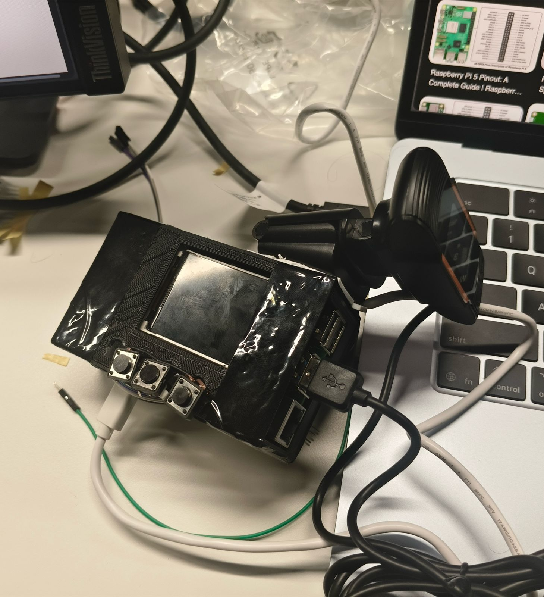
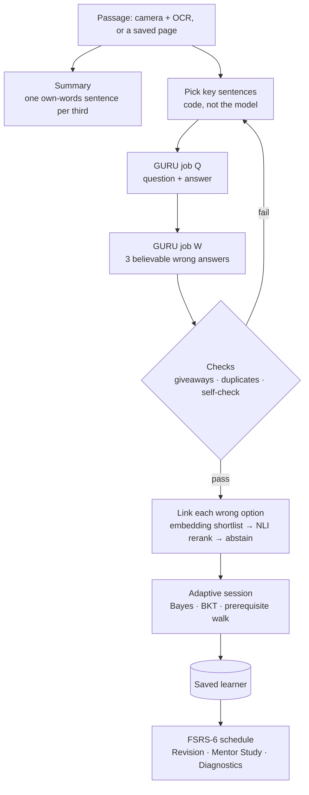
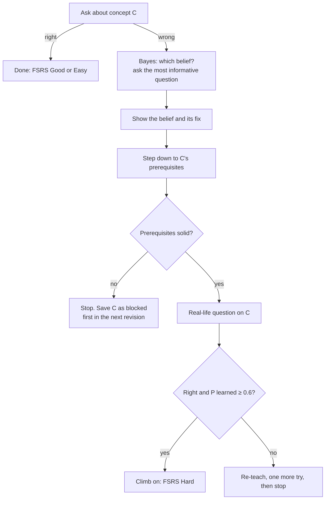
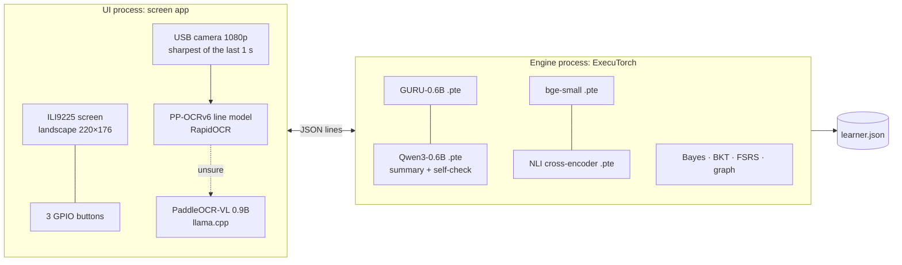
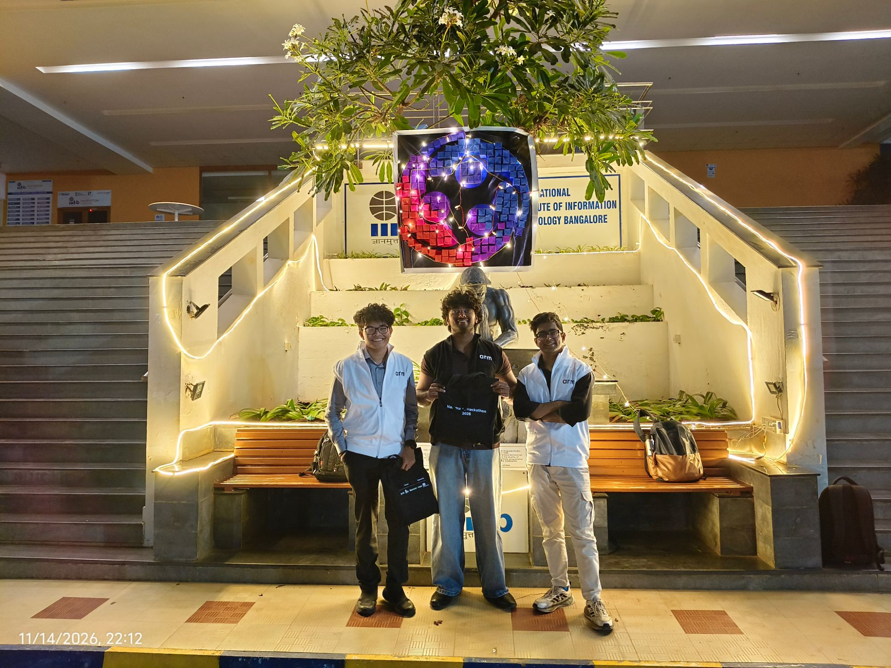

<div align="center">

# SAKSHI

**An offline tutor that finds the belief behind a wrong answer**

*Quizzes, knowledge tracing and spaced revision on a Raspberry Pi 5, with the network off*

**Winner · Namma AI Hackathon 2026 (Arm × IIIT Bangalore × NASSCOM) · Problem Statement 1: AI for Inclusive Education**

Felicitated at Bengaluru Tech Summit 2026 · ₹1,50,000 prize

Powered by **GURU-0.6B**: **G**rounded **U**nderstanding, **R**uns **U**nplugged

[Model release](https://github.com/ArushJain-697/namma-ai/releases/tag/guru-0.6b-v1) · [Design decisions](docs/JUDGE_BRIEF.md) · [Learning-engine maths](docs/RETENTION_MATH.md) · [MIT licence](LICENSE)



*The device: Raspberry Pi 5 in a 3D-printed case, 176×220 screen, three buttons, USB camera for photographing a page.*

</div>

---

## Overview

A student working through a textbook page on her own can't tell whether she understood it, and there's nobody to
correct her if she didn't. A quiz gives her a score, which tells her she got something wrong but not why. If she
believes that friction only acts on objects that are already moving, she takes that belief into every chapter that
builds on it.

Sakshi takes a 150-300 word passage and gives back a short summary and a quiz in which each wrong option is a known
student misconception, drawn from a graph of 4,080 of them. When she picks a wrong option, Sakshi works out which
belief she probably holds, explains the fix, checks the simpler idea underneath, and only moves back up once she has
learned it. On later days it asks about the belief again until it's gone. All of this runs on a Raspberry Pi 5 with
ExecuTorch and no internet connection.

For each passage, Sakshi:

1. Writes a summary a Class 6-10 student can follow.
2. Picks the sentences worth asking about. Code makes this choice, not the model.
3. Writes a question and three wrong answers a confused student would find believable, then links each wrong answer to a named misconception.
4. Estimates which belief she holds from her answers. "No specific belief" is always one of the possibilities, so a single slip doesn't label her.
5. Tracks whether she has learned each idea or got lucky.
6. Predicts when she'll forget each idea and decides what she should revise first.

Every number in this README comes from a script we ran, and each design choice is written up with its evidence in
[`docs/JUDGE_BRIEF.md`](docs/JUDGE_BRIEF.md). We looked for published evidence before building each part, and we kept
the results that went against us. For example, we tried small fact-checking models on 10 questions whose answer keys
we knew were wrong. They caught at most 3 of the 10, so we left that check out.

## Features

| Capability | Description |
|---|---|
| GURU-0.6B quiz model | Qwen3-0.6B fine-tuned with LoRA in two jobs: write question + answer, write 3 believable wrong answers |
| On-device inference | ExecuTorch 1.5.1, 4-bit weights / 8-bit activations, XNNPACK on the Arm Cortex-A76 CPU |
| Misconception graph | 4,080 misconceptions, 5,585 concepts, 120 root beliefs, 6,052 prerequisite links, 258 Class 6-10 topics |
| Wrong answer → belief | Embedding shortlist, NLI cross-encoder rerank, abstains when unsure; right belief in the top 3 81% of the time |
| Bayesian diagnosis | Picks the next question by expected information gain; names a belief only at 75% confidence |
| Knowledge tracing | BKT per concept; the climb back up needs a right answer *and* P(learned) ≥ 0.6 |
| Prerequisite walk | Wrong answer → fix → step down to the idea underneath → climb back up with real-life questions |
| Spaced revision | FSRS-6 per concept; review days re-check old beliefs and follow the graph to related ones |
| Quality checks | Code picks the key sentence, giveaway and duplicate checks, a second model must agree on the answer |
| Streaming quiz | Questions arrive one by one: the next is written while the child answers the current one, so she waits only for the first |
| The device | 220×176 screen, 3 buttons, camera + on-device OCR, passages loaded from storage |

> **Decision:** we picked Qwen3-0.6B to fit a budget of about one minute for a summary and a quiz on the Pi. Qwen3-1.7B has roughly three times the weights, so it writes about three times slower, and on our data it wasn't clearly better (held-out loss 1.273 vs 1.256: a gap smaller than the 0.02–0.04 run-to-run seed noise, so not evidence either way; the 1.7B run also had an anomalous starting loss). [Why →](docs/JUDGE_BRIEF.md#1-model-qwen3-06b-4-bit-executorch-xnnpack-on-the-arm-cpu)

---

## Problem statement (Namma AI 2026 · Problem 1)

| Requirement | What Sakshi delivers |
|---|---|
| One learning barrier and learner group | Class 6-10 students in low-connectivity government schools, studying alone; only **67.5%** of Class 8 rural government-school students can read a Class 2 text (ASER 2024) |
| An organiser passage, lightweight model, ExecuTorch, Raspberry Pi | GURU-0.6B, **ExecuTorch 1.5.1** on a **Raspberry Pi 5 (8 GB)**, Arm CPU only |
| Summary + at least 3 quiz questions | Summary and 3+ multiple-choice questions, each answer shown with the passage sentence that proves it: **~70 s** end to end with the shipped pipeline (an older pipeline measured 57.9 s in one run) |
| No cloud inference; report time, model, size, memory | Network off; a run card after every run: **469 MB** model, **3.2 GB** peak for the whole engine |
| Impact explanation with an example from the passage | A named misconception with its fix, e.g. *"Friction only acts on objects that are already moving"* named once the child has picked it consistently (a scripted demo student, not a real child) |

---

## What makes it different

1. **It explains wrong answers.** Each wrong option is linked to a named belief, so a wrong answer tells you what the child believes. The hackathon asked for a quiz; Sakshi also reports the reason behind each mistake.
2. **The model doesn't decide alone.** Code picks the sentence to ask about, rules reject questions that give the answer away, a second model has to agree on the correct answer, and every answer comes with the sentence that proves it. A question that fails any of these is dropped.
3. **One answer doesn't label a child.** "No specific belief" stays a possibility, a belief is only named at 75% confidence, and a right answer that is still inconclusive gets one more question before a belief is cleared.
4. **Learning is checked over days.** Mastery today is the chance she learned the idea times the chance she still remembers it. When a belief is gone, Sakshi checks a related belief with the same root to see whether the underlying habit has changed.

> **Decision:** we tested one of our own pitch claims and dropped it. A bot that picks whichever option sounds most like
> the passage scored 66% on our best prompt-only version, against 25% by chance, so "our quiz beats word-spotting"
> wasn't true for that version. [Why →](docs/JUDGE_BRIEF.md#6-question-quality-the-hardest-problem-attacked-with-measurement)

---

## Architecture

### End-to-end pipeline



> **Decision:** one model call per question rather than one call for the whole quiz, because small models break long structured outputs. The model put the correct answer in option A about 80% of the time, so code shuffles the options. Questions with three options are kept, since three options test as well as four (Rodriguez 2005, a review of 80 years of research). [Why →](docs/JUDGE_BRIEF.md#4-time-budget-decided-from-token-counts)

### Questions arrive one at a time

The child doesn't wait for the whole quiz. The first question appears as soon as it passes the checks, and while she
reads and answers it, a background thread writes, checks and links the next one. The Pi takes about 16 s to write a
question and a child takes about 20-40 s to answer one, so after the first question she doesn't wait at all.

| Child's wait before each question (Mac, pretend child taking 4 s per answer) | Q1 | Q2 | Q3 |
|---|---|---|---|
| Streaming (shipped) | 3.4 s | 0 s | 0 s |

> **Decision:** stream the questions instead of writing them all first. Each question takes just as long to write
> (that's the time we report for judging), but the child spends less time waiting. Building this turned up a bug: the
> ExecuTorch runner collects the model's text by redirecting the program's output, so the child's screen was being
> swallowed by that capture and one question went missing. We ruled out threads, CPU load and the helper models, then
> gave the screen its own output channel. Streaming now produces the same questions as writing them in one batch. [Why →](docs/JUDGE_BRIEF.md#questions-stream-to-the-child-write-the-next-one-while-the-child-answers-14-nov)

### The session: step down, climb back up



### The device



---

## Tech Stack

| Area | Technology |
|---|---|
| On-device inference | ExecuTorch 1.5.1, XNNPACK, `TextLLMRunner`, custom SDPA + KV cache |
| Models | Qwen3-0.6B → GURU-0.6B (LoRA), bge-small-en-v1.5 embedder, nli-MiniLM2-L6-H768 cross-encoder |
| Training | PyTorch, PEFT LoRA, answer-only loss, gradient checkpointing (CUDA or Apple MPS) |
| Export | optimum-executorch: `8da4w`, group size 32, 8-bit embeddings, `max_seq_len 1024` |
| Learning engine | Bayes with expected information gain, Bayesian Knowledge Tracing, py-fsrs 6.3.2 (FSRS-6) |
| Device | Raspberry Pi 5 (8 GB), ILI9225 SPI screen, gpiozero, OpenCV, RapidOCR (PP-OCRv6) on ONNX Runtime, PaddleOCR-VL-1.5 on llama.cpp |
| Language and testing | Python 3.12-3.13, pytest |

---

## Deep Dive: The Layers

### Layer 1: the quiz model (GURU-0.6B)

One model does two jobs, and the system prompt says which. Job Q gets a 3-sentence window and the key sentence and
writes a question and its answer. Job W also gets that question and answer and writes three wrong answers a student
would believe. Splitting the work keeps each call short enough for a 0.6B model, and the single combined model did
better at both jobs than two separate specialists (held-out loss 1.217 vs 1.227, and 1.429 vs 1.439; these gaps are within seed noise, so treat the two as tied).

### Layer 2: wrong answer → misconception

For a wrong option *x*, the candidates are the misconceptions in the passage's topics, which cuts about 4,000 down to
16-50. They are ranked by embedding similarity, re-ranked with an NLI cross-encoder, and the option is left unlinked if
nothing is similar enough:

$$\text{score}(m) = \cos(e_x, e_m) + 0.3\,P_{\text{entail}}(x \Rightarrow m), \qquad \text{link}(x) = \begin{cases} \arg\max_m \text{score}(m) & \cos \ge 0.76 \\ \text{none} & \text{otherwise} \end{cases}$$

An unlinked option counts as a plain wrong answer and adds no evidence for any belief, so a weak match can't produce a diagnosis.

> **Decision:** retrieve-and-rerank, the usual two-stage search design, made small enough to run offline on a Pi and measured on about 3,600 pairs we labelled ourselves. The re-ranker only adds 1 point (46% to 47%). It's cheap, so we kept it. [Why →](docs/JUDGE_BRIEF.md#7-linking-each-wrong-option-to-a-misconception-retrieve-and-rerank-run-on-a-pi)

### Layer 3: Bayesian diagnosis

The possibilities for a concept are its misconceptions, NONE (knows it) and RANDOM (guessing: every option 1/n). If she
holds belief *m* and it appears as an option, we assume she picks it with probability 0.50 and spreads the rest over the
other options. A right answer or an untagged wrong answer never raises a misconception above RANDOM. The update and the choice of
next question:

$$P(h \mid o) = \frac{P(o \mid h)\,P(h)}{\sum_{h'} P(o \mid h')\,P(h')}, \qquad \text{EIG}(q) = H(P) - \sum_o P(o)\,H\big(P(\cdot \mid o)\big)$$

A belief is named only when its probability is at least 0.80 **and** she picked it at least twice, more often than any other belief. Otherwise the quiz says "not sure yet". In simulation, a random guesser gets a belief falsely named on 3.8% of diagnosed concepts (it was 45.8%), and a child who always picks their belief's option gets it named 55% of the time on 3-question concepts (100% when there are more questions to ask). Banks need 5 or more questions per concept for this to work well.

> **Decision:** "no specific belief" is always one of the possibilities. Without it, any random wrong answer would look like evidence for some misconception, and one slip would label a child. [Why →](docs/JUDGE_BRIEF.md#9-the-retention-engine-every-design-decision-and-why-14-nov)

### Layer 4: Bayesian Knowledge Tracing

With slip *s* = 0.10, guess *g* = 0.25 (recall) or 0.15 (real-life question) and learning rate *T* = 0.2:

$$P(L \mid \checkmark) = \frac{P(L)(1-s)}{P(L)(1-s) + (1-P(L))\,g}, \qquad P(L \mid \times) = \frac{P(L)\,s}{P(L)\,s + (1-P(L))(1-g)}, \qquad P(L) \leftarrow P(L) + (1-P(L))\,T$$

One wrong answer takes her from 0.30 to 0.24. One right answer to a real-life question takes her from 0.24 to 0.72,
which is above the 0.6 she needs to move back up. We use 0.6 to mean "ready to build on"; the usual BKT bar for
mastery is 0.95.

> **Decision:** BKT instead of deep knowledge tracing. Deep models do about as well as chance (AUC around 0.5) for a brand-new student and are too heavy for a Pi. BKT works from the first answer, and each update takes microseconds. [Why →](docs/JUDGE_BRIEF.md#8-learner-model-chosen-for-zero-data-and-a-small-cpu)

### Layer 5: forgetting (FSRS-6)

Each concept has a stability *S* and a difficulty *D*. The chance she still recalls it after *t* days, with *F* set so that *R*(*S*, *S*) = 0.9:

$$R(t, S) = \left(1 + F\,\frac{t}{S}\right)^{-w_{20}}, \qquad F = 0.9^{-1/w_{20}} - 1$$

On review days the two are combined, and revision starts with the ideas most at risk:

$$P(L)_{\text{today}} = P(L)_{\text{saved}} \cdot R(t, S), \qquad \text{priority}(C) = 1 - P(L)_C \cdot R_C(t)$$

> **Decision:** FSRS with its default settings, which aren't fitted to children yet. With those settings a memory that's stable for 7 days is still about 77% likely to be recalled at day 30, so we don't show steep forgetting curves. [Why →](docs/JUDGE_BRIEF.md#8-learner-model-chosen-for-zero-data-and-a-small-cpu)

### Layer 6: review days

Each belief she held is checked again with a new question, using two possibilities (she still holds it, or she
doesn't) and the same likelihoods. If she still holds it, she sees the fix again and the next review comes sooner. If
it's gone, Sakshi asks about a related belief: one it `causes` if the graph has that link, otherwise the closest belief
with the same root in another topic. That shows whether the underlying habit has changed.

---

## Benchmarks

### On the Raspberry Pi 5 (8 GB, Cortex-A76, no network)

| Measurement | Value |
|---|---|
| Prefill / decode | **122 / 12.1 tokens/s** |
| Summary + 3 questions, one terminal run, start to finish | **57.9 s** = load 3.0 + summary 14.2 + quiz 40.7 (single run, older pipeline; the shipped pipeline takes ~70 s and needs a repeated measurement) |
| On the device, average time to write each question (hidden: written while the child answers the previous one) | **15.7 s** |
| Summary on the device (one sentence per third) | **9.2 s** |
| Peak memory: GURU alone / + summary model / whole engine | **1.48 / 2.7 / 3.2 GB** |
| Model file (4-bit) | **469 MB** |

### What we optimised, measured before and after

| Change | Before | After |
|---|---|---|
| Stop each call when the answer is complete (the model never wrote its end token) | 147 s | **86 s**, identical output |
| Context sized to the job: `max_seq_len` 2,048 → 1,024 | 2.49 GB | **1.67 GB**, same answers 8/8 |
| Second wrong-answer run removed (identical in 38/38 calls) | 6.7 s/question | **4.6 s/question** (Mac) |
| Summary: whole passage → one own-words sentence per third | 86 words, 44% copied | **44 words, 26% copied** |
| Camera capture mode | 640×360 | **1920×1080** |

> **Decision:** the context limit matches what a quiz call needs. We also measured and rejected 4-bit embeddings, which saved only 74 MB and changed all 8 test answers, and a larger quantization group, which changed nothing. [Why →](docs/JUDGE_BRIEF.md#3-memory-cut-by-a-third-with-zero-quality-change)

### Question quality (40 frozen test passages, blind-graded)

| Version | Result |
|---|---|
| Plain Qwen3-0.6B, best of 4 prompts | **19%** sensible, answer key right 73% |
| Version 1: LoRA on SciQ + RACE (4,300 questions) | **30%** sensible, answer key right 82% |
| Two-job GURU vs single-call | blind read **8/12** vs 3/12 good; answer is the longest option **6%** vs 15%; why/how questions **49%** vs 39% |

> **Decision:** the teacher data was graded before we trained on it. Of 1,794 questions actually graded (2,773 were written) for 401 syllabus passages, a separate grader kept 1,039 that scored 4-5 and passed every hard rule. None of them overlap with the 40 test passages; we checked for shared 8-word runs. [Why →](docs/JUDGE_BRIEF.md#6-question-quality-the-hardest-problem-attacked-with-measurement)

### Quantization cost (held-out loss, Q job / W job)

| Precision | Loss |
|---|---|
| bf16 | 1.217 / 1.429 |
| 8-bit (`8da8w`, 720 MB) | 1.223 / 1.436 (near-lossless) |
| **4-bit (`8da4w`, 469 MB, shipped)** | 1.345 / 1.564 |

> **Decision:** two builds of each model, chosen automatically. The fast kernels need the Arm dot-product instructions, and on an Arduino UNO Q (Cortex-A53) they crashed with "Illegal instruction". The installer now reads `/proc/cpuinfo` and picks the portable build when needed. We rehearsed on the UNO Q with the network off: the install took 4 min 10 s. [Why →](docs/JUDGE_BRIEF.md#2-two-exports-chosen-automatically-by-the-cpu)

### Misconception linking (3,647 labelled wrong-option → misconception pairs)

| Metric | Value |
|---|---|
| Right belief ranked first / in the top 5, on a held-out half of passages (`results/mapping_eval_v2.json`) | **52% / 83%** on the device path (59% / 91% when the topic is known) |
| Precision answering only the most confident 75% / 25% | 57% / 64% |
| Right topic for test passages | **39 / 40** |
| Off-syllabus passages caught | **12 / 12**, 0 false alarms |

> **Decision:** we found a bug in our own data. A run that rebuilt the graph's links during a usage limit quietly dropped them from 1,955 to 843 and erased the root-belief names. Rebuilding is now incremental and won't save a worse file. [Why →](docs/JUDGE_BRIEF.md#5-the-misconception-graph-built-before-the-event-used-offline)

### Learning engine, simulated over days 0, 1, 3 and 7

| Behaviour | Result |
|---|---|
| Passing a concept | Needs P(learned) ≥ 0.70 **and** 2 right answers in the last 3 attempts; the guess rate is never below 1/n, so one lucky right answer can't pass it |
| Forgetting | Applied once per elapsed interval (it used to compound on every review); first review after 1 day, second after 3 |
| Review questions | No question is asked twice (19.9% of review questions used to repeat) |
| A belief that only looked held from one guess | 55% → **36%**, cleared next day |
| A blocked concept | Climbs back up on day 7, once its base is solid |

---

## Positioning against prior work

- The idea that each wrong option should reveal a specific misconception comes from Eedi's diagnostic questions. Eedi uses a fixed bank of hand-written questions; Sakshi writes them for any passage, offline, with a 0.6B model.
- There's good evidence for this kind of practice. An adaptive tutor raised maths scores by 0.37 SD in 4.5 months in a Delhi RCT (Muralidharan, Singh, Ganimian 2019), and refutation texts ("you might think X; actually Y") correct misconceptions with g ≈ 0.41 (Tippett 2010).
- Letting code decide and the model only explain comes from Toddle AI, and summary prompts that keep numbers and names from LENTERA. Both are MIT-licensed, and we used the ideas, not their code.

---

## The device

The menu has three parts. Study takes a photo of a page, a saved page, or Mentor Study for old mistakes. Revision
shows how well she knows each idea and what's due. Diagnostics shows where she's stuck and what to do next. Every
screen reads from the engine and her saved progress. To load passages before an event:

```bash
pi/send_passages.sh --paste judge1        # the clipboard becomes ~/passages/judge1.txt on the Pi
~/start_sakshi.sh                         # on the Pi: screen + buttons
```

---

## Project Structure

```
pi/                 device: offline installer, tests, screen UI (pi/ui/sakshi.py), passage upload
scripts/            sakshi_engine.py (engine behind the screen), sakshi_app.py (one-program app),
                    backup_quiz.py (quiz pipeline), dataset builders, evaluation
src/sakshi/         backends (ExecuTorch), misconception library and linking, retention/ (Bayes, BKT, FSRS, sessions)
train/              LoRA fine-tuning and the export recipe
data/               misconception graph, training datasets, frozen test passages
results/            evaluation outputs behind every number above
docs/               JUDGE_BRIEF (every decision with evidence), RETENTION_MATH, SUBMISSION, pitch/, history/
research_notes/     research behind the design choices
tests/              pytest suite
```

---

## Installation

```bash
git clone https://github.com/ArushJain-697/namma-ai.git && cd namma-ai
python -m venv .venv && .venv/bin/pip install executorch==1.5.1 torch numpy tokenizers fsrs pytest
bash scripts/get_models.sh          # GURU, the summary model, the helper models and the index (checksum-verified)
```

`get_models.sh` downloads from the [GURU-0.6B v1 release](https://github.com/ArushJain-697/namma-ai/releases/tag/guru-0.6b-v1)
and picks the fast or portable build for your CPU. Add `--8bit`, `--adapters` or `--all` for more. On a Raspberry Pi,
use the offline installer `pi/install.sh` with the checklist in `pi/CHECKLIST.md`; the exact packages are listed in
`pi/requirements-pi.txt`.

```bash
python scripts/sakshi_app.py study passage.txt     # summary, streamed questions, adaptive session
python scripts/sakshi_app.py review                # a later day: re-check misconceptions, follow the graph
```

---

## Testing

```bash
python -m pytest -q --ignore=tests/test_resident.py     # 214 tests
python -m pytest -q tests/test_retention.py             # Bayes, BKT, prerequisite walk, FSRS scheduling
python -m pytest -q tests/test_review.py                # climb gate, blocked concepts, review days
```

`test_resident.py` needs Linux namespaces (`unshare`) and runs on the Pi.

---

## Glossary

| Term | Meaning |
|---|---|
| Diagnostic question | A multiple-choice question whose wrong options each reveal a specific misconception |
| Misconception | A wrong belief students commonly hold, with why they hold it and its fix |
| Root belief | A deeper habit of thinking behind many misconceptions, e.g. "a rule that works in one case works everywhere" |
| Two-job model | One fine-tuned model whose system prompt selects the job: write the question, or write the wrong answers |
| EIG | Expected information gain: how much an answer is expected to shrink uncertainty about her belief |
| BKT | Bayesian Knowledge Tracing: the probability she has learned a concept, separating learning from guesses and slips |
| FSRS | Free Spaced Repetition Scheduler: predicts recall over time and schedules revision |
| Climb gate | The rule that she moves back up the prerequisite graph only when right *and* P(learned) ≥ 0.6 |
| Abstain | Leaving a wrong option unlinked when no misconception matches confidently |
| 8da4w | 8-bit dynamic activations, 4-bit weights: the ExecuTorch quantization recipe used for GURU |
| Self-check | A second model answers each question with shuffled options; disagreement drops the question |

---

## Documentation

- [`docs/JUDGE_BRIEF.md`](docs/JUDGE_BRIEF.md): every design decision, with the measurement behind it
- [`docs/RETENTION_MATH.md`](docs/RETENTION_MATH.md): the learning engine's maths in full
- [`docs/SUBMISSION.md`](docs/SUBMISSION.md): the five mandatory deliverables
- [`docs/pitch/`](docs/pitch/): slide facts and the pitch deck
- [`docs/history/`](docs/history/): the original design plan, red-team log and proposal
- [`THIRD_PARTY_NOTICES.md`](THIRD_PARTY_NOTICES.md): models, datasets and licences

---

## Known limitations

An internal audit (20 Nov 2026) found problems that the numbers above have been corrected for. What is still open:

- **No real-student data.** Every diagnosis number comes from simulated students. The likelihoods (0.50 etc.) are set by hand and need a pilot to fit.
- **The shipped 4-bit pipeline's quality is unmeasured.** Quality numbers come from bf16 or simulated quantization. The test passages were also used during development.
- **Held-out losses are optimistic.** The validation set overlapped v1's (200 of 310 rows) and checkpoints were picked on it. Seed noise is about 0.02–0.04, so most model comparisons here are ties. `train/finetune_mac.py` now takes a separate `--test` set and a `--seed`.
- **The demo bank has 3 questions per concept**, which is too few for the stricter diagnosis to name a belief in one session.
- **The off-syllabus gate's catch rate is unmeasured** (no off-syllabus test set yet). It raised no false alarms on 401 syllabus passages.
- **The EOS fix is tested against a fake runner only**, not yet on the Pi.
- **Licensing:** RACE passage text is in `data/`; see `THIRD_PARTY_NOTICES.md` and `MODEL_CARD.md`.

## Licence

The code is under the [MIT licence](LICENSE). The model weights in the release were trained on SciQ (CC BY-NC 3.0)
and RACE (research use only), so they can be used for research and education but not commercially.

---

## Team

<div align="center">



**Trishanu Mazumdar · Vishnu Suhas Chinta · Arush Jain**


</div>
